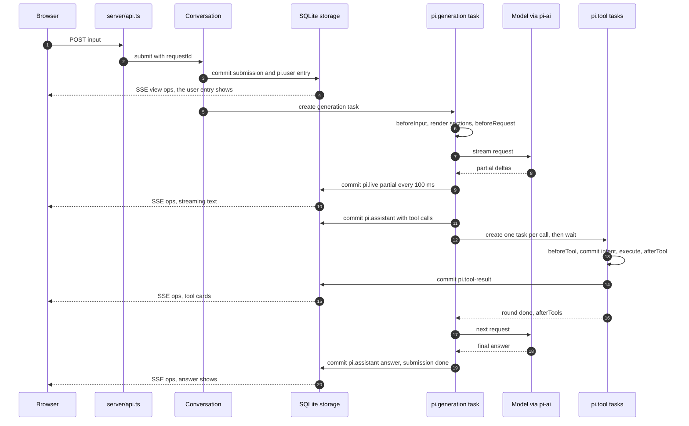
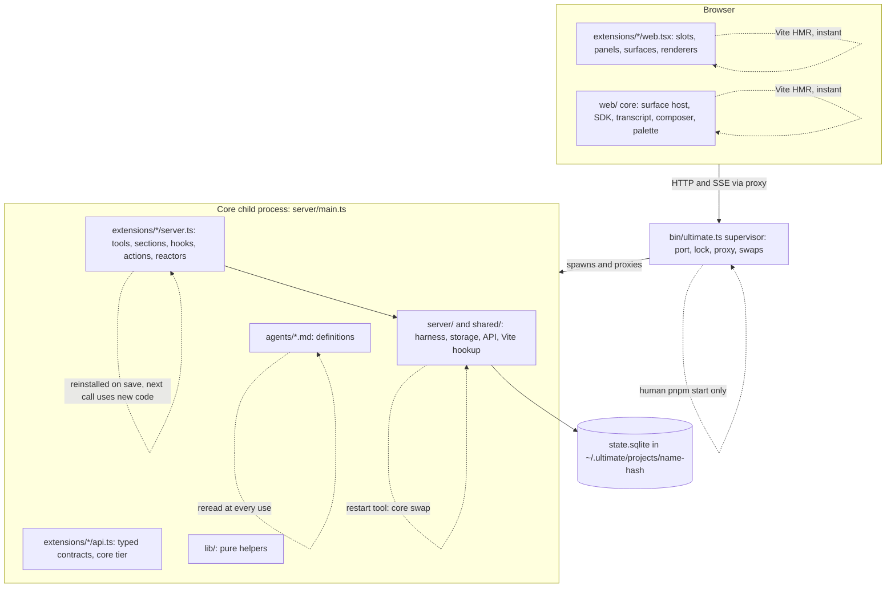
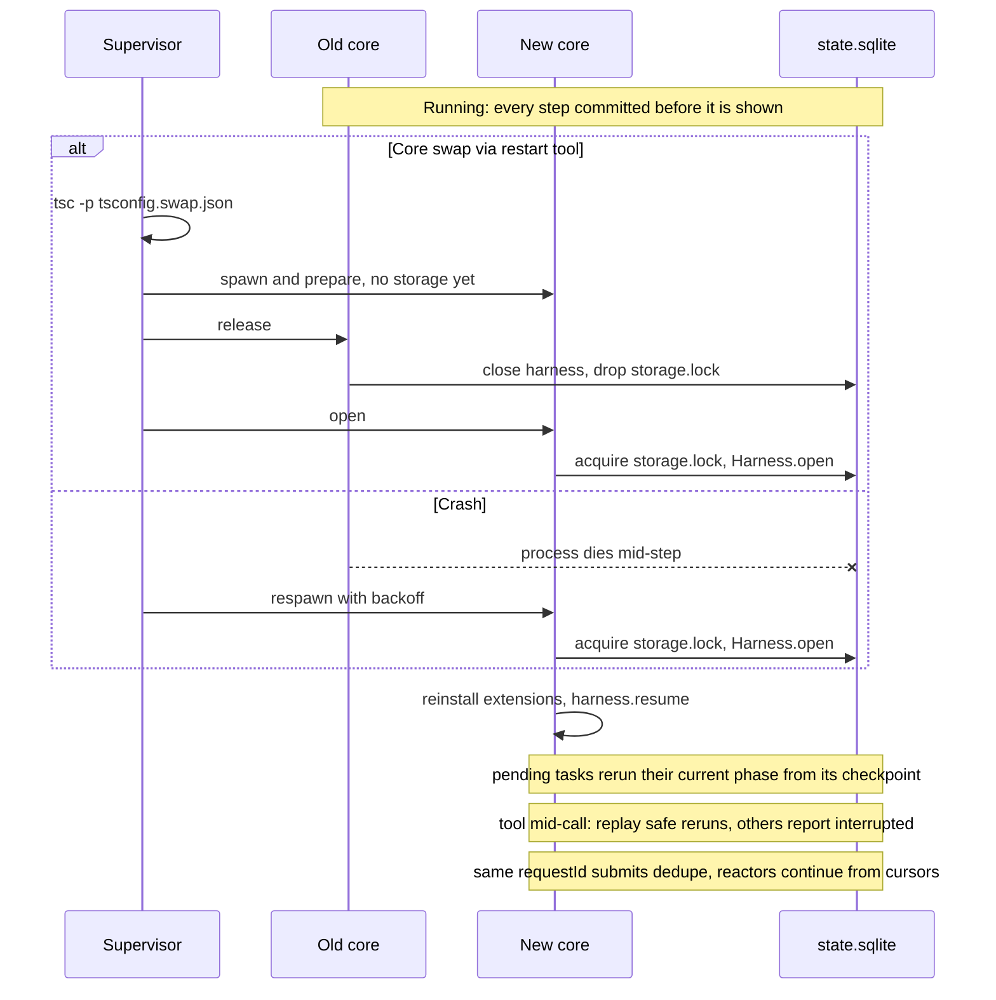
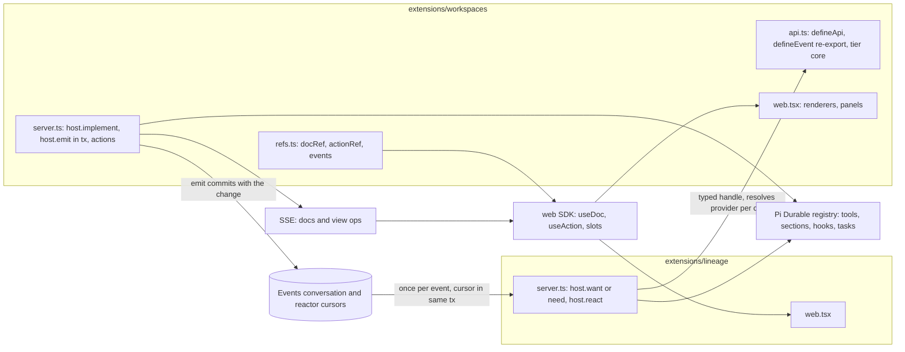
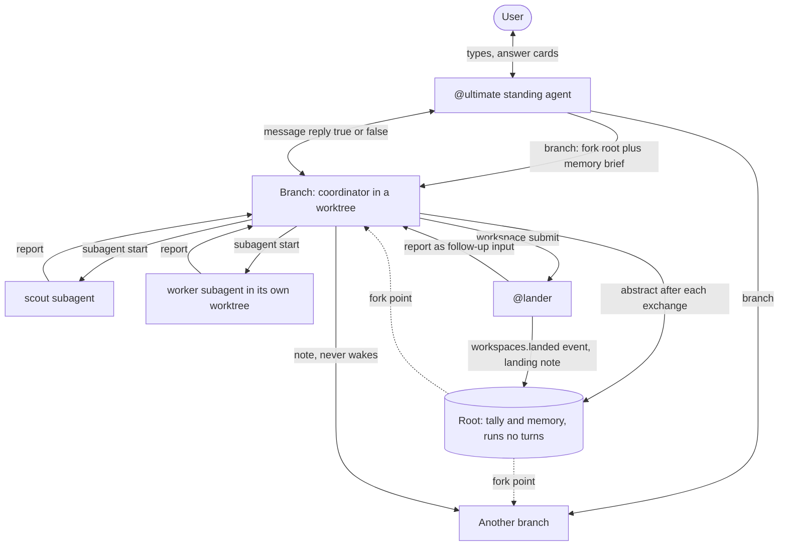
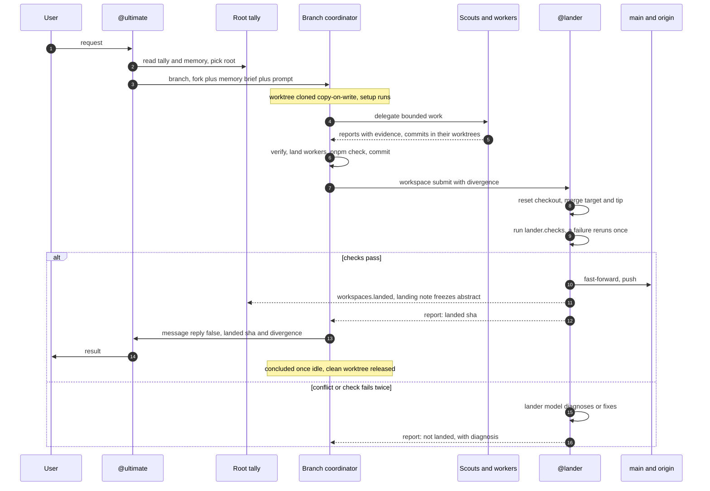

# Architecture primer: Pi Durable and Ultimate

How Ultimate works, from the storage commit up to a branch landing on `main`, in KISS terms: the few primitives
everything is built from, what is deliberately not built, and where each piece lives.

The file references point into this repository. `PD/` is short for `node_modules/@earendil-works/pi-durable/`
(its `README.md` and `dist/` types). The line numbers are as of this commit.

**Contents:** [1. The idea in one page](#1-the-idea-in-one-page) ·
[2. Pi Durable](#2-pi-durable-the-durable-harness) · [3. Ultimate on top](#3-ultimate-on-top) ·
[4. Organising work](#4-organising-work-the-conversation-forest) · [5. Principles](#5-kiss-principles) ·
[6. Core primitives](#6-the-core-primitives) · [7. Glossary](#7-glossary) · [8. Where to look next](#8-where-to-look-next)

---

## 1. The idea in one page

Ultimate is a local coding agent with a web UI. It runs from the repository it edits, so it can change itself while
you talk to it (`AGENTS.md:3-5`). Three layers stack:

| Layer           | What it gives                                                                                        | Where                                                   |
| --------------- | ---------------------------------------------------------------------------------------------------- | ------------------------------------------------------- |
| **Pi** packages | Model/provider access (`pi-ai`), Pi's settings, auth, skills and trust store (`pi-coding-agent`)     | `node_modules/@earendil-works/pi-ai`, `pi-coding-agent` |
| **Pi Durable**  | A durable agent harness: every entry, task step and document change is an atomic commit to storage   | `PD/`                                                   |
| **Ultimate**    | A supervisor, a small server core, and **extensions** (server + web facets) that build every feature | `bin/`, `server/`, `shared/`, `extensions/`, `web/`     |

One sentence for each layer: Pi talks to models. Pi Durable makes the agent loop crash-proof by committing before showing
anything (`PD/README.md:5`). Ultimate is a thin host whose features are almost all extensions that hot-reload
(`extensions/README.md:3-6`).

The rule that makes the whole thing work: **nothing is shown or acted on before it is committed**, and **everything
that runs is a task with a checkpoint**. A crash, a restart or a core swap reopens the same SQLite file, and work
continues from the last checkpoint (`docs/durability.md:3-6`).

---

## 2. Pi Durable: the durable harness

### 2.1 The vocabulary

From `PD/README.md:92-104`, each with one line:

| Concept          | Definition                                                                                                                                                              |
| ---------------- | ----------------------------------------------------------------------------------------------------------------------------------------------------------------------- |
| **Harness**      | One open storage plus the machinery that runs agents on it; all changes go through one line of atomic commits.                                                          |
| **Conversation** | A transcript of immutable entries. Handles hold no state.                                                                                                               |
| **Entry**        | One immutable transcript record: `pi.user`, `pi.assistant`, `pi.tool-result`, `pi.system`, `pi.reset`, `pi.compaction`, or your own kind (`PD/dist/entries.d.ts:4-28`). |
| **Commit**       | One atomic write: entries, document edits and new tasks together, or nothing.                                                                                           |
| **Document**     | Typed JSON state next to the transcript, changed only in commits (`pi.agent`, `pi.live`, `pi.inbox`, `pi.usage`, …).                                                    |
| **Task**         | A durable state machine that checkpoints every step. Every task has an owner: a conversation or another task.                                                           |
| **Submission**   | What you hand a conversation (an input or an entry to write); you can wait for it, also after a restart.                                                                |
| **Turn / run**   | A turn is one model response and its tool calls; a run is the turns from an input to its final answer.                                                                  |
| **Extension**    | A named bundle of tools, prompt sections, hooks, wraps and tasks, installed in a **registry**.                                                                          |
| **Agent**        | What a conversation runs with (model, thinking, extensions, tools, instructions, cwd), stored by _name_ in `pi.agent`.                                                  |

Storage is pluggable: memory, IndexedDB, SQLite, JSONL, a Cloudflare Durable Object (`PD/README.md:759-767`).
Ultimate uses SQLite (`server/harness.ts:236-242`), which runs in WAL mode (`PD/README.md:765`).

### 2.2 Tasks and checkpoints

A task is a registered, versioned state machine: `initial(input)` makes the first checkpoint and named **phases**
advance it (`PD/dist/types.d.ts:294-354`). Its committed state is one of `pending`, `running`, `waiting` (on other
tasks), `sleeping` (until a clock time), `completing`, or terminal (`PD/dist/types.d.ts:546-579`).

- **A phase reruns from its top after a restart.** There is no sleep in the middle of a phase; whatever the next step
  needs goes into the checkpoint (`PD/README.md:162`).
- **Waiting and sleeping hold no invocation.** A waiting task resumes when its children settle (`allSettled` or
  `failFast`); a sleeping one when the clock reaches `until`, across restarts (`PD/README.md:140-162`, `:704-706`).
- **Abort runs bottom-up**: owned work is aborted first, then the task's own abort handler (`PD/README.md:706`).
- **Crash loops are bounded**: a task cut off by crashes `restartLimit` times (default 5) is parked as
  `restart_limit` until someone retries it (`PD/README.md:216`).

### 2.3 The agent loop is just tasks

The harness answers an input with two built-in task kinds (`PD/README.md:106-113`):

```text
submit(input) → pi.user
  pi.generation → pi.system (only if the prompt or tools changed), pi.assistant (tool calls)
    pi.tool × n → pi.tool-result × n   (owned by the generation, which waits for them)
  pi.generation → pi.assistant (answer) → submission done
```

`pi.generation` prepares the prompt and tools, streams the model request, classifies and retries the response, then
creates one `pi.tool` task per tool call and waits for the round (`PD/dist/harness/generation.d.ts:8-57`).

**Tools and replay.** Each tool call is its own task, and its _intent_ is committed before `execute()` runs. After a
crash, a tool declared `replay: "safe"` reruns; any other gets an `interrupted` error result with the output committed
so far (`PD/README.md:277`, `PD/dist/harness/tool.d.ts:22-30`). That is the whole exactly-once story: Pi Durable never
pretends a side effect happened once; it makes you say whether a rerun is harmless. Ultimate requires a reason comment
on every `replay: 'safe'` (`docs/durability.md:5-7`).

A tool can call other tools (`api.executeTool()`); each nested call is a child task with its own replay policy, keyed
so a replay-safe caller gets its earlier nested calls back (`PD/README.md:307-331`). Code mode builds on this: a
QuickJS script's tool calls are journaled, and after a restart the deterministic script reruns against the journal
(`PD/README.md:355-368`).

**Busy conversations.** Inputs to a busy conversation queue in `pi.inbox` (`PD/README.md:504-521`):

- **steer**: placed after the current tool round, joins the running work;
- **follow-up**: placed when the run answers, starts the next run;
- **write**: appends an entry without asking the model (at once if the model would not see it).

### 2.4 The life of one user message



The browser never sees anything that is not yet in SQLite: the UI is a view over committed state
(`PD/README.md:474-502`, `server/api.ts:85-105`). Partial answers and tool output are committed at most every 100 ms,
so a crash loses at most that window (`PD/README.md:502`).

### 2.5 Hooks, sections and wraps

Extensions change the built-in tasks only through these points (`PD/dist/harness/types.d.ts:786-838`,
`PD/dist/harness/define.d.ts:4-17`):

| Hook / helper                        | Runs                                                      | Can                                                                                |
| ------------------------------------ | --------------------------------------------------------- | ---------------------------------------------------------------------------------- |
| `beforeInput` (generation)           | Before a new run's first input is placed, inside its `tx` | Add entries that commit with the input. _Ultimate patch_ (`docs/pi-upstream.md:4`) |
| `beforeRequest` (generation)         | Before every request attempt                              | Replace the messages of that one request                                           |
| `afterResponse` (generation)         | On every terminal provider message                        | Observe                                                                            |
| `onYield` (generation)               | On a final answer                                         | `continue` the run with another user message                                       |
| `afterTools` (generation)            | Once a round's tools are terminal                         | Observe                                                                            |
| `beforeTool` (tool)                  | Before intent is committed                                | `block` the call or rewrite its arguments; a throw blocks                          |
| `afterTool` (tool)                   | After execution, before the result commits                | Replace the result                                                                 |
| `beforeCompact` (compaction)         | After range selection, before summarizing                 | `decline`, or supply its own `summary`                                             |
| `section(key, render)`               | Each request                                              | Add a system prompt section                                                        |
| `wrapTool(tool, fn)` / `wrapSection` | Wherever the wrapping extension is selected               | Decorate whichever tool or section won by name                                     |

Only changed sections and tools are sent again as positional `pi.system` entries, which keeps provider prompt caches
warm (`PD/README.md:370-378`). A throwing hook is reported and skipped; a throwing `beforeTool` blocks
(`PD/README.md:825`).

**Reload is per phase.** Installing an extension with an existing name replaces it in place. A running tool call
finishes on its old code; the next phase, request or call uses the new one (`PD/README.md:462-472`). This is what lets
Ultimate reinstall `server.ts` facets on save.

### 2.6 Documents, compaction, forks and reset

- **Documents** are typed JSON with a scope (session, conversation, task), a history policy (`latest` or
  `rewindable`) and a **fork policy** (`initial`, `current`, `asOf`) (`PD/README.md:726-749`,
  `PD/dist/types.d.ts:32-74`). They commit with the entries they belong to.
- **Reset** writes a `pi.reset` head marker; the model sees entries from the newest head onward, older ones stay
  stored (`PD/README.md:539-548`).
- **Compaction** is a task that summarizes an older prefix into a `pi.compaction` entry whose head is the first kept
  entry. It runs in the background before the threshold, or blocks the next request past it, and after a
  context-overflow error it compacts and retries once (`PD/README.md:550-588`).
- **Fork** creates a conversation that sees its parent's entries up to an entry and continues alone, with the parent's
  agent as of that entry and a fresh provider session (`PD/README.md:627-634`).

Storage is append-only throughout: reset, compaction and fork change what the model _sees_, never what is _stored_.
That is why Ultimate can always search history from before a compaction (`ultimate.search()`).

### 2.7 Errors and recovery

Three rules (`PD/README.md:819-825`): a storage error ends the harness (reopen to recover; commits are atomic); an
invalid read fails only that call; your code fails only its own unit (a throwing phase faults that task, a throwing
tool returns an error result). A retried `submit` with the same `requestId` finds the existing submission
(`PD/README.md:125-133`). That one idempotency key is how every Ultimate delivery (reports, notes, lander messages)
survives replay without duplicates.

---

## 3. Ultimate on top

### 3.1 Layers and how each one reloads



The table in `AGENTS.md:51-62` is the source: `web.tsx` and `web/` hot-reload through Vite; `server.ts` is
reinstalled on save; `api.ts` reloads with its importers; `agents/` is read at each use; `server/` and `shared/` need
the `restart` tool; `bin/` only a human restart. The guidance follows from it: **put behaviour in `extensions/`, not
`server/`, because it reloads without a restart** (`AGENTS.md:64`).

### 3.2 The supervisor and the core swap

`bin/ultimate.ts` is deliberately tiny. It resolves the project and its state home, takes the single-instance lock,
owns the public port (first free from 4747) behind a loopback proxy, and runs the core as a child process
(`bin/ultimate.ts:71-96`, `:129-138`, `:187-221`; `docs/running.md:3,11`).

A swap (`restart` tool or `POST /api/restart`):

1. type-checks with `tsc --noEmit -p tsconfig.swap.json` (`bin/ultimate.ts:349-369`);
2. boots and prepares the new child **without storage** while the old one keeps serving;
3. asks the old child to `release` storage, then lets the new one open it and resume (`bin/ultimate.ts:394-444`);
4. on failure before release, kills the new child and the old one keeps serving; after release, the old one
   `reacquire`s (`bin/ultimate.ts:428-432`).

No run state is copied between processes: the new process opens the same `state.sqlite` and Pi Durable resumes every
pending task (`server/harness.ts:222-242`). A crashed child restarts with backoff; after three failed boots the
supervisor serves diagnostics and retries on file changes (`docs/running.md:10`, `bin/ultimate.ts:458-505`).

### 3.3 Crash and restart recovery



The agent sees a hot swap as a "Build changed" note placed before its next input (`docs/pi-upstream.md:13`), and a
tool that reports "interrupted" may or may not have finished, so it checks before retrying.

### 3.4 Server core: small on purpose

`server/` is plumbing (`AGENTS.md:61`):

- `server/harness.ts` opens Pi Durable over SQLite, with Pi's `ModelRuntime` and `SettingsManager`
  (`server/harness.ts:11`, `:124-153`, `:222-242`) and per-model compaction thresholds (`docs/settings.md:26-33`).
- `server/main.ts` serves loopback HTTP: `/api/` to the API, everything else to Vite (`server/main.ts:34-85`).
- `server/api.ts` streams state to browsers over **server-sent events** (`GET /api/events`: system, view ops,
  documents, task graph; `server/api.ts:85-105`, `:304-350`) and invokes extension actions at
  `POST /api/extensions/:name/actions/:action` (`server/api.ts:107-149`).
- `server/extensions.ts` discovers, validates and installs extension facets (below); `server/events.ts` provides durable
  events and reactors; `server/trace.ts` records every call into `trace.sqlite` (`docs/extensions.md:153-194`).

### 3.5 The extension model

Almost everything is an extension, including the conversation UI itself (`extensions/README.md:3-6`). A folder
`extensions/<name>/` holds up to these files (`docs/extensions.md:3-8`, `:120-148`):

| File        | Role                                                                                            |
| ----------- | ----------------------------------------------------------------------------------------------- |
| `server.ts` | A Pi Durable extension (tools, sections, hooks, tasks) plus `actions`, `docs`, reactors         |
| `web.tsx`   | Browser facet from `defineWebExtension` (`@/sdk`): slots, panels, surfaces, renderers, commands |
| `api.ts`    | Typed server contract for other extensions; `export const tier = 'core'` joins the core tier    |
| `refs.ts`   | Browser-safe refs: `docRef`, `actionRef`, event tokens                                          |
| `ui.tsx`    | What other extensions' browser code may import                                                  |
| `README.md` | Its documentation; the first paragraph is its summary                                           |

**Discovery** is three folders, later names replacing earlier ones whole: built-in `extensions/`, user
`~/.ultimate/extensions/`, project `<project>/.ultimate/extensions/` (`extensions/README.md:45-56`). Adding a folder is
the opt-in; `defaultOff` built-ins need `extensions.enable` (`shared/extension-api.ts:61`).

**Reload.** Server facets load through Vite's `ssrLoadModule`, are validated, and are installed into the Pi Durable
registry; file watchers reinstall a changed facet and its dependents, and a failed load keeps the previous version
(`server/extensions.ts:480-538`, `:645-697`; `docs/extensions.md:8`). Web facets come from a generated virtual module
of lazy imports, replaced in place by Vite HMR (`server/vite-extensions.ts:10-21`, `web/src/extensions.ts:13-60`).

**Talking to each other**: four channels, chosen by what crosses them (`docs/extensions.md:150-151`):

| Channel       | For                      | API                                                                            |
| ------------- | ------------------------ | ------------------------------------------------------------------------------ |
| Service       | Calls between extensions | `defineApi` in `api.ts`; `host.implement`, `host.need`, `host.want`            |
| Document      | Durable state            | `defineDoc`; `useDoc(ref)` in the browser                                      |
| Durable event | "This happened"          | `defineEvent`; `host.emit(tx, …)`, `host.react(name, [Event], fn)`             |
| Action        | The UI and user boundary | `actionRef` + `implementAction`; `POST …/actions/:action`, `ultimate.action()` |



- **`need` vs `want`.** `need` is a hard dependency (an error while nothing provides it); `want` is optional and returns
  undefined. Handles resolve the current provider on every access, so they survive provider reloads
  (`docs/extensions.md:102-111`, `server/extension-apis.ts:47-132`).
- **Core tier.** The always-on heart (agent, prompt, coding-tools, conversations, models, documents, notices, secrets,
  theme, workspaces, subagents, lineage, messages, onboarding, sidebar) depends only on itself, in nine layers, one way
  (`docs/extensions.md:61-89`). When a lower layer needs something a higher one knows, it declares an **extension
  point** and the higher one implements it (`docs/extensions.md:91-118`). `pnpm deps` fails on a cycle or a core
  extension depending on an optional one.
- **Durable events.** An event commits _inside_ the transaction that makes the change, and a reactor's cursor advances
  in its handler's transaction, so reactor writes happen exactly once; effects outside the transaction are at least
  once (`docs/extensions.md:17-32`, `server/events.ts:55-80`). Events live in one ownerless "Events" conversation
  (`docs/durability.md:11-15`).

### 3.6 Surfaces and the web SDK

The web core provides only the frame: surface host, primitives, the live data layer, transcript, composer and palette
(`extensions/README.md:3-6`). A **surface** is a full-screen app; Agent (`extensions/agent`) is the built-in one; the
choice is durable UI state `shell.surface`, and a failed surface falls back to Agent with a notice
(`extensions/README.md:640-668`). The SDK (`web/src/sdk/index.ts`) exports the contribution types (slots, panels,
surfaces, tool/entry renderers, commands) and hooks (`useDoc`, `useAction`, `useTranscript`, `useUiState`). Renderers
compose: each extension renderer for an entry kind receives the previous rendering as `core`, behind an error boundary
with that as fallback (`web/src/app/transcript.tsx:1010-1020`, `web/src/sdk/registry.ts:499-508`).

### 3.7 Settings, trust and discovery

Everything layers the same way, **built-in → user → project, later wins** (`docs/settings.md:3`):

| What       | Layers                                                                                                     |
| ---------- | ---------------------------------------------------------------------------------------------------------- |
| Extensions | `extensions/`, `~/.ultimate/extensions/`, `<project>/.ultimate/extensions/`                                |
| Agents     | `agents/`, `~/.ultimate/agents/`, `<project>/.ultimate/agents/` (overlays with `addTools` extend)          |
| Skills     | clone `skills/`, `.pi/skills/`, `~/.ultimate/skills/`, then trusted `.agents/skills/`, `.ultimate/skills/` |
| Settings   | defaults, `~/.ultimate/settings.json`, `<project>/.ultimate/settings.json`; live, no restart               |

**Trust gates the project layer.** A project's `.ultimate/` (extensions, settings, agents, skills) loads only once the
user chose the project; the decision lives in `~/.ultimate/trust.json` via Pi's `ProjectTrustStore`, and a linked
worktree shares its main checkout's decision (`docs/settings.md:37-42`, `server/project-setup.ts:15-64`). That file is
shared by every host, so tools and tests never write it per run (project memory `trust-json-is-shared`).

### 3.8 Multiple projects and instances

One supervisor serves one project: its home is `~/.ultimate/projects/<basename>-<sha256 first 8>/` with its own
`state.sqlite`, `trace.sqlite`, locks, port and Vite cache (`docs/running.md:12`, `docs/worktrees.md:3`). Starting the
same project again opens the running window instead (`server/lock.ts:60-99`). Projects find each other through
manifests (`project.json`, `conversations.json`) and live URLs, never by opening another project's SQLite
(`docs/durability.md:9`, `server/project.ts:40-68`); `ultimate.tell` messages another project's @ultimate. Previews
(`instance start`) are separate temporary instances with their own home (`docs/running.md:16`).

---

## 4. Organising work: the conversation forest

### 4.1 Roots, branches, standing agents

A project is a forest of conversation trees, like commit histories (`AGENTS.md:7-9`). Everything below is built from
Pi Durable conversations, forks, entries and documents in a handful of extensions (`lineage`, `messages`,
`subagents`, `workspaces`).

| Thing         | What it is                                                                                                            | Where                                                 |
| ------------- | --------------------------------------------------------------------------------------------------------------------- | ----------------------------------------------------- |
| **Root**      | Runs no turns. Holds the **tally** (read-only project context) and the **memory** (decisions, facts, lessons by slug) | `extensions/lineage/README.md:24-50`, `:83-122`       |
| **Branch**    | A fork of the root for one feature or fix, run by a **coordinator**, usually in its own worktree                      | `extensions/lineage/README.md:6-23`                   |
| **@ultimate** | The user's standing agent: starts and steers branches, the only one that may message the user                         | `agents/ultimate.md`, `extensions/messages/README.md` |
| **@lander**   | Standing conversation per source checkout that lands submissions; a model runs only on failure                        | `extensions/workspaces/README.md:82-115`              |
| **Subagent**  | A child conversation for bounded work (scout, worker, designer, reviewer), owned by a background anchor               | `extensions/subagents/README.md:1`                    |

A branch does not inherit the whole tally when its root has memories: its fork gets a `pi.reset` carrying a
**memory brief** (the index plus the last 10 landings), and the full tally stays readable with `ultimate.entries(root)`
(`extensions/lineage/README.md:102-109`). The tally itself is fed by **abstracts** (each conversation's latest
summary, edited in place until it lands), **notes** and **landing notes** (`extensions/lineage/README.md:44-82`).

### 4.2 Message and note flow



- **`message`** wakes the recipient (steer or follow-up); with `reply: true` the answer returns as `board.reply`.
  Only @ultimate may message the user; a subagent may message only its parent (`extensions/messages/README.md:5-40`).
- **`note`** writes a `lineage.note` that the target reads with its next input, without waking it
  (`extensions/lineage/README.md:59-62`).
- **`notify`** tells you when another conversation finishes (`extensions/lineage/README.md:144-151`).
- **Catch-up**: a branch resumed after idling gets a "Meanwhile in #R's tree" note and new target commits, placed with
  its input by the patched `beforeInput` hook (`extensions/lineage/README.md:152-166`).

### 4.3 Workspaces and isolation

An isolated conversation gets its own Git worktree at `<home>/worktrees/<conversationId>`
(`extensions/workspaces/README.md:13-14`). By default it is a **copy-on-write clone** of the source checkout (APFS
`clonefile` on macOS, `cp --reflink=always` on Linux), so `node_modules` comes along nearly free; then tracked files are
reset to the branch and untracked ones removed. Without clone support it checks out plainly
(`extensions/workspaces/README.md:15-26`). Project setup commands (`isolates.worktree.setup`) run next and must be
safe to repeat (`extensions/workspaces/README.md:27-40`). Isolation is a working directory, not a sandbox
(`extensions/subagents/README.md:90`). Removal only deletes clean, fully landed checkouts
(`extensions/workspaces/README.md:52-71`).

### 4.4 A branch from start to landing



### 4.5 The lander and checks

The lander is mostly code: one `workspaces.lander` task per source processes the queue in order, in its own detached
checkout at `<home>/lander/<hash>` (`extensions/workspaces/README.md:87-108`, `:138-170`):

1. reset to the target tip, fetch and merge the remote when ahead;
2. merge the submitted tip (a conflict reports the paths);
3. run `lander.checks` in order, groups concurrently, each with no-output and total timeouts; a failing check reruns
   once and is flaky if it then passes;
4. fast-forward the target, up to three attempts if it moved;
5. push (never forced) when `lander.push` is set;
6. commit `landed` and emit `workspaces.landed` in the same transaction, then report to the submitter.

The lander's **model** runs only on a merge conflict or a twice-failed check, in `diagnose` or `fix` mode
(`extensions/workspaces/README.md:186-201`). This repository runs `pnpm check`, then `pnpm test` and `pnpm test:e2e`
in parallel (`docs/worktrees.md:13`).

### 4.6 Subagents and coordinators

`subagent start` creates a child conversation configured from a Markdown **definition** (frontmatter: model,
thinking, tools, isolate, resident, …) read from three folders, later by name (`extensions/subagents/README.md:17`,
`lib/agents.ts`). Every child belongs to an independent background anchor task, so stopping the parent does not stop
it; a durable reporter delivers its answer once, including after a restart (`extensions/subagents/README.md:1-15`).
Children cannot delegate unless their definition lists `subagent`. A branch is never a subagent: it is a top-level
conversation, and its coordinator owns the plan and the verdict (`AGENTS.md:22-29`, `agents/coordinator.md`).
`resident: true` makes a definition a standing agent with one pinned conversation per project
(`extensions/subagents/README.md:21-25`).

### 4.7 Automations

One `automation` tool covers four triggers (cron/at/every **schedules**, durable **events**, **context** thresholds,
and **scripts** a `watcher` agent writes and repairs) and two actions (start a fresh **prompt** run, or wake
**subscribers**) (`extensions/automations/README.md:1-60`). Schedules are root-owned tasks that commit
plan → sleep → fire, so a sleep survives restarts and overdue fires run once (`:17`). Event triggers are one reactor
whose cursor commits with the fire (`:13`). Script processes are supervised with a pid handshake and process-group
cleanup (`:66`). A runaway is paused at the seventh fire in an hour (`:48`).

---

## 5. KISS principles

What Ultimate chooses, and what it deliberately does **not** build:

| Principle                          | What it means                                                                                                                  | Not built, and why                                                                                       |
| ---------------------------------- | ------------------------------------------------------------------------------------------------------------------------------ | -------------------------------------------------------------------------------------------------------- |
| **Commit before you show**         | Every entry, step and doc change is an atomic SQLite commit first (`PD/README.md:5`, `docs/durability.md:3`)                   | No in-memory session state to sync or migrate between processes; a restart is just "open the file again" |
| **Everything that runs is a task** | Generation, tools, compaction, landers, schedules, reporters: one checkpointed state machine model (`PD/README.md:99`)         | No separate job queue, cron daemon or retry service                                                      |
| **Honest replay**                  | A tool reruns only if declared replay-safe; otherwise it reports `interrupted` (`PD/README.md:277`)                            | No fake exactly-once for side effects; idempotency is a `requestId` or a memo, explicitly                |
| **Append-only history**            | Reset, compaction, fork and go-back change what the model sees, not what is stored (`PD/README.md:539-634`)                    | No destructive edits; nothing to undo, everything searchable                                             |
| **One file per project**           | Each project home has its own `state.sqlite` and one owner process (`docs/running.md:12`)                                      | No database server, no cross-process locking, no shared multi-project store                              |
| **A tiny supervisor**              | `bin/` only owns the port, lock and swaps; changes rarely (`AGENTS.md:62`)                                                     | No orchestration layer; the core swaps itself with a type-checked handover                               |
| **Features are extensions**        | Even the Agent surface is one; new UI is a new folder (`extensions/README.md:3-6`, `AGENTS.md:64-68`)                          | No feature code in `server/` or `web/` that would need a restart                                         |
| **Typed, one-way contracts**       | `api.ts` services, `need`/`want`, points and events; core tier depends only downward (`docs/extensions.md:61-118`)             | No global event bus for state, no cycles, no untyped `provide`/`use`                                     |
| **Layering over configuration**    | Built-in → user → project, later wins, for extensions, agents, skills and settings (`docs/settings.md:3`)                      | No plugin registry, no config DSL; a folder _is_ the opt-in                                              |
| **Behaviour lives in prompts**     | Rules about how agents act live in `agents/*.md` and prompts; code guards only safety and invalid states (`AGENTS.md:110-111`) | No policy engine; lint enforces only what the user asked for                                             |
| **Isolation by directory**         | Worktrees (copy-on-write clones), not containers (`extensions/subagents/README.md:72,90`)                                      | No sandboxes or remote machines; cheap, fast, Git-native                                                 |
| **One gate to main**               | Only the lander merges, checks, fast-forwards and pushes; a model only on failure (`extensions/workspaces/README.md:87-93`)    | No CI dependency for landing; no agent pushes directly                                                   |
| **Talk without waking**            | Notes, notify and tallies share context without starting runs (`AGENTS.md:32-34`)                                              | No polling agents, no shared chat room every agent reads                                                 |
| **Platform first**                 | SQLite, Git worktrees, APFS clones, SSE, Vite HMR, Node 26 running `.ts` directly (`AGENTS.md:93-99`)                          | No custom build system, no new dependency without a reason in its commit                                 |
| **No compatibility shims**         | Move forward and update callers; Pi patches are tracked and dropped when upstream ships (`docs/pi-upstream.md:35-36`)          | No speculative fallbacks                                                                                 |

---

## 6. The core primitives

Everything above is composed from these. If you learn only one table, learn this one.

| #   | Primitive                   | One line                                                                                                              | Where it lives                                                           |
| --- | --------------------------- | --------------------------------------------------------------------------------------------------------------------- | ------------------------------------------------------------------------ |
| 1   | **Commit**                  | One atomic write of entries, documents and tasks; nothing is visible before it                                        | `PD/README.md:97`; `conversation.commit`, `api.commit`                   |
| 2   | **Entry**                   | One immutable transcript record; built-in kinds plus `defineEntry`                                                    | `PD/dist/entries.d.ts:4-28`                                              |
| 3   | **Document**                | Typed JSON state with scope, history and fork policy, changed in commits                                              | `PD/README.md:726-749`; `defineDoc`, `docRef` in `refs.ts`               |
| 4   | **Task**                    | A checkpointed, owned state machine; phases rerun from the top after a restart                                        | `PD/dist/types.d.ts:294-354`, `:546-579`                                 |
| 5   | **Conversation**            | A transcript with an agent; forkable, ownable by a task                                                               | `PD/README.md:95`, `:627-681`                                            |
| 6   | **Submission**              | A durable input or write, deduped by `requestId`, steer or follow-up when busy                                        | `PD/README.md:125-133`, `:504-521`                                       |
| 7   | **Tool**                    | A schema-validated call run as its own task, with a replay policy                                                     | `PD/README.md:245-305`; `defineTool`                                     |
| 8   | **Hook / section / wrap**   | The only ways to change the built-in loop: before/after input, request, tool, compaction; prompt sections; decorators | `PD/dist/harness/types.d.ts:786-838`, `PD/dist/harness/define.d.ts:4-17` |
| 9   | **Extension facet**         | A folder with `server.ts` (Pi Durable extension, actions, reactors) and `web.tsx` (UI contributions), hot-reloaded    | `extensions/README.md`, `server/extensions.ts`, `web/src/sdk/`           |
| 10  | **Contract**                | `api.ts` service tokens (`need`/`want`), extension points, `refs.ts` doc/action refs                                  | `shared/extension-api.ts`, `docs/extensions.md:100-151`                  |
| 11  | **Durable event + reactor** | "This happened", committed with the change; handled once per reactor via a cursor in the same tx                      | `shared/events.ts`, `server/events.ts:55-80`                             |
| 12  | **Agent definition**        | Markdown + frontmatter profile for subagents, standing agents, automations and the lander                             | `agents/*.md`, `lib/agents.ts`                                           |
| 13  | **Workspace**               | A per-conversation Git worktree, copy-on-write cloned, with a record in `ultimate.workspaces`                         | `extensions/workspaces/`                                                 |
| 14  | **Layered folder**          | Built-in → user → project, later wins; trust gates the project layer                                                  | `server/discovery.ts`, `server/project-setup.ts`, `docs/settings.md`     |

Composed examples:

- **A branch** = fork (5) of the root + reset entry with the memory brief (2) + `lineage.branch` doc (3) + a
  `lineage.prompt` task (4) that submits (6) the first input + a workspace (13).
- **A message** = a typed input entry (2) submitted (6) with a request id, emitting `board.sent` (11), answered by a
  delivery task (4).
- **A landing** = a lander task (4) running checks, whose commit (1) records `landed` and emits `workspaces.landed`
  (11); lineage's reactor writes the landing note (2) into the root exactly once.
- **A schedule** = a root-owned task (4) that sleeps durably and fires, creating a run conversation (5).

---

## 7. Glossary

| Term                    | Meaning                                                                                                                                   |
| ----------------------- | ----------------------------------------------------------------------------------------------------------------------------------------- |
| **Abstract**            | A conversation's latest summary in its root's tally, edited in place until it lands (`extensions/lineage/README.md:51-58`)                |
| **Anchor (background)** | The background task that owns a subagent, so the parent's stop and idle waits do not reach it                                             |
| **Brief**               | The memory index plus recent landings a branch starts from instead of the full tally                                                      |
| **Chapter**             | One `state.sqlite` generation of a project home; "Fall asleep" starts a fresh one (`server/harness.ts:131`, `extensions/dream/README.md`) |
| **Coordinator**         | The agent that runs a branch: plans, delegates, verifies, submits (`agents/coordinator.md`)                                               |
| **Core swap**           | Replacing the core child process with type-checked new code, handing over storage (`bin/ultimate.ts:394-444`)                             |
| **Core tier**           | The always-on extensions, depending only on each other, one way (`docs/extensions.md:61-89`)                                              |
| **Divergence**          | How a result differs from the task as given, stated at submit; "None" when it matches                                                     |
| **Extension point**     | A contract a lower extension declares and `want`s, which a higher one implements                                                          |
| **Facet**               | One side of an extension: server (`server.ts`) or web (`web.tsx`)                                                                         |
| **Isolate**             | Where a child's tools run; today only `none` or `worktree`                                                                                |
| **Lander**              | The serial, code-driven gate that merges, checks, fast-forwards and pushes                                                                |
| **Memory**              | A root's slugged decisions, facts and lessons (`lineage.memory`), at most 150                                                             |
| **Note**                | Context left in another conversation for its next turn, without waking it                                                                 |
| **Reactor**             | A handler run once per durable event, its cursor committed with its writes                                                                |
| **Replay-safe**         | A tool that may rerun after a crash; every other tool reports `interrupted`                                                               |
| **Root**                | A conversation that runs no turns and holds a tree's tally and memory                                                                     |
| **Standing agent**      | A `resident: true` definition's one pinned conversation per project (@ultimate, @lander, …)                                               |
| **Steer / follow-up**   | Input placed after the current tool round / when the run answers                                                                          |
| **Surface**             | A full-screen app in the window; Agent is the built-in one                                                                                |
| **Tally**               | A root's read-only record of branches, abstracts, notes and landings; the UI calls it **context**                                         |

---

## 8. Where to look next

| To understand…                    | Read                                                                                                                                                                           |
| --------------------------------- | ------------------------------------------------------------------------------------------------------------------------------------------------------------------------------ |
| Pi Durable end to end             | `PD/README.md`, then the runnable `PD/test/examples` (14-chat, 22/23 subagents, 24 child tasks, 31 reload and restart), and the upstream spec linked at `PD/README.md:868-872` |
| Hook and task types               | `PD/dist/harness/types.d.ts`, `PD/dist/types.d.ts`, `PD/dist/harness/generation.d.ts`, `PD/dist/harness/tool.d.ts`                                                             |
| Layers and conventions            | `AGENTS.md`                                                                                                                                                                    |
| Starting, swapping, resetting     | `docs/running.md`, `bin/ultimate.ts`, `server/main.ts`, `server/harness.ts`                                                                                                    |
| Durability, events, documents     | `docs/durability.md`, `docs/extensions.md`, `server/events.ts`                                                                                                                 |
| Writing an extension or surface   | `extensions/README.md`, the `write-extension` skill, `extensions/status-line`, `extensions/coding-tools`                                                                       |
| Trees, memory, notes, catch-up    | `extensions/lineage/README.md`                                                                                                                                                 |
| Messages and the user boundary    | `extensions/messages/README.md`                                                                                                                                                |
| Subagents and definitions         | `docs/subagents.md`, `extensions/subagents/README.md`, `agents/`                                                                                                               |
| Worktrees and the lander          | `docs/worktrees.md`, `extensions/workspaces/README.md`                                                                                                                         |
| Automations                       | `extensions/automations/README.md`                                                                                                                                             |
| Settings and trust                | `docs/settings.md`, `server/discovery.ts`, `server/project-setup.ts`                                                                                                           |
| What is patched or copied from Pi | `docs/pi-upstream.md` (`rg "Pi upstream:"`)                                                                                                                                    |
| Inspecting a live system          | codemode `ultimate.*`: `entries`, `search`, `taskGraph`, `trace`, `catalogue`, `api(name)` (`docs/extensions.md:196-198`)                                                      |
